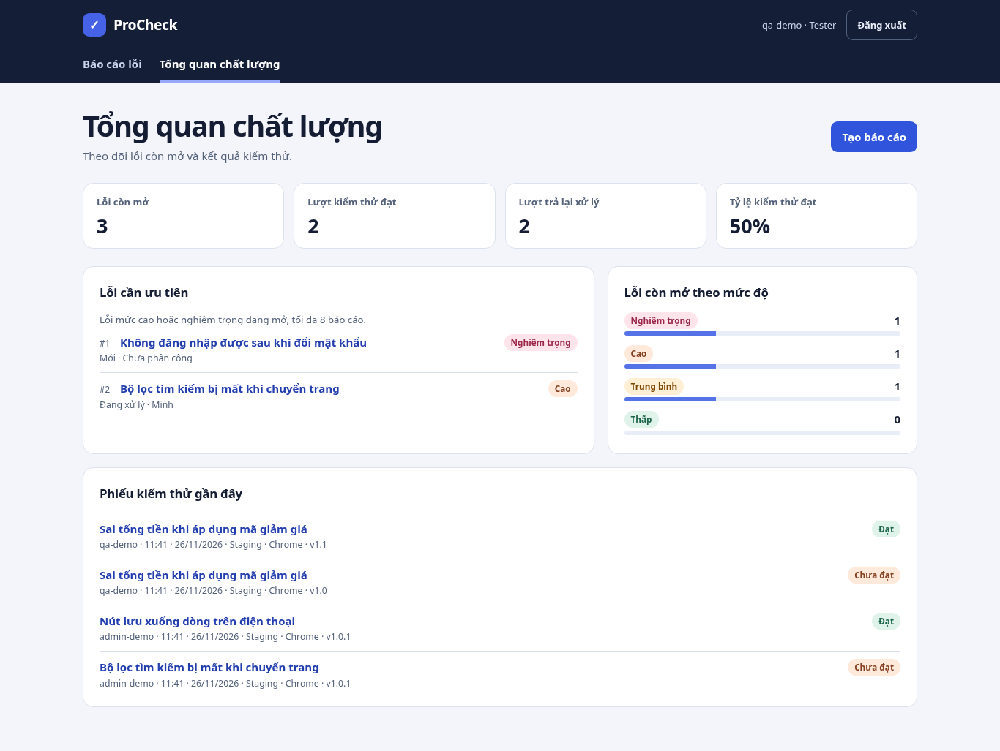
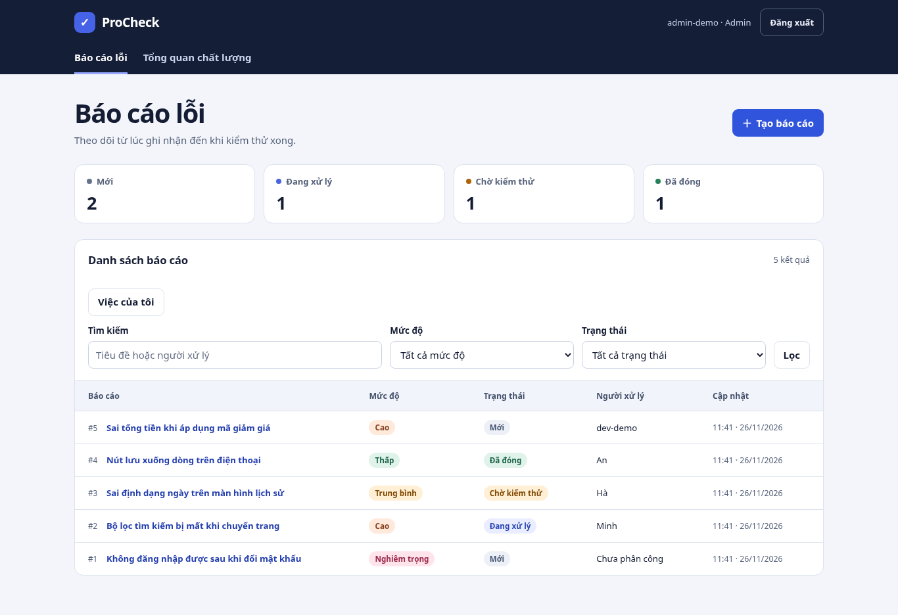
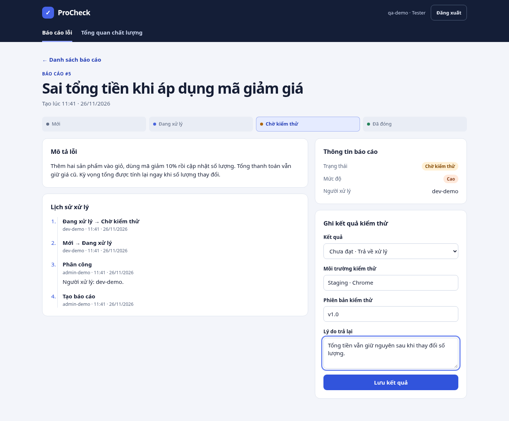
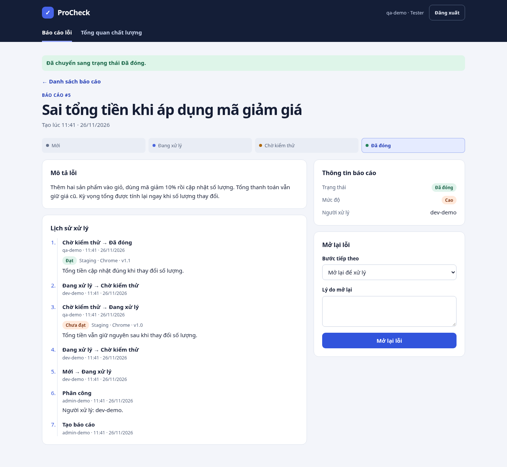

# ProCheck · Issue Tracker and QA Dashboard

[](.github/workflows/ci.yml)
[](LICENSE)
<!-- After publishing, replace the CI badge with https://github.com/OWNER/REPO/actions/workflows/ci.yml/badge.svg and link it to the workflow page. -->

Track software defects from intake through verification. Assign a report to a developer, verify a fix against a named build, and reopen the issue with a reason if the defect returns. The interface is in Vietnamese.

**Stack** · Python 3.11+, Flask, SQLAlchemy, Alembic, Jinja, JavaScript, SQLite and SQL Server via ODBC.



| Issue list and filters | QA verification form | Verification and assignment history |
| --- | --- | --- |
|  |  |  |

## Features

- **Issue tracking** with search, severity and status filters, pagination and a **My work** filter.
- **Role-based permissions** for Admin, Developer and Tester. Assignments reference workspace accounts.
- **QA records** include outcome, environment, build and observations. Reopening requires a reason and is visible in the audit history.
- **Quality dashboard** shows open high-severity issues, severity counts and pass rates per verification attempt across the workspace.

| Role | Permissions |
| --- | --- |
| Admin | Create and assign issues, edit issues still being worked on, move through the workflow, record QA results and reopen |
| Developer | Create issues and work on assigned or unassigned issues through the handoff to QA |
| Tester | Create issues, record verification results, return failed fixes and reopen closed issues |

## Quick start · macOS / Linux

From the repository root with Python 3.11+:

```sh
python3 -m venv .venv
.venv/bin/python -m pip install -r requirements.txt
test -f .env || cp .env.example .env
.venv/bin/python -c 'from dotenv import dotenv_values, set_key; from secrets import token_hex; key = dotenv_values(".env").get("SECRET_KEY"); set_key(".env", "SECRET_KEY", key if key and len(key) >= 32 else token_hex(32)); set_key(".env", "DATABASE_BACKEND", "sqlite")'
.venv/bin/python -m flask --app procheck db-upgrade
.venv/bin/python -m flask --app procheck create-user admin-demo --role admin
.venv/bin/python -m flask --app procheck seed-demo admin-demo
.venv/bin/python -m flask --app procheck run --port 5050
```

Open [localhost:5050](http://127.0.0.1:5050). The create-user command prompts for a password of at least 12 characters. For a full role-based demo, also create `dev-demo --role dev` and `qa-demo --role tester` with the same command. Sign in as admin, assign a report to the developer, send it to QA as the developer, and verify or reopen it as the tester.

## Online demo · Render

`render.yaml` defines a read-only SQLite demo. Push the repository, connect it in Render using **New → Blueprint**, and deploy. Once deployed, add the assigned URL to this README. Demo sign-in uses **`demo`** / **`ProCheck-Demo-2026!`**. The service seeds its own sample dataset and uses a generated session key. Free instances may take time to wake and recreate the sample dataset after a restart.

## Technical highlights

| Implementation | Purpose |
| --- | --- |
| Version column and SQLAlchemy optimistic locking | Reject stale forms and detect concurrent database updates |
| Single transaction per workflow change | Commit or roll back the issue, audit event and QA evidence together |
| Backend authorization and CSRF tokens | Enforce role rules on POST requests, including direct requests to protected routes |
| CSP and scrypt password hashing | Restrict browser resource loading and store password hashes instead of plaintext |
| UTF-16 length validation | Match SQL Server `NVARCHAR` capacity, including characters that occupy two UTF-16 code units |
| Alembic migrations | Upgrade supported existing schemas while preserving accounts, issues and audit history |

## SQL Server · Docker Compose

Use an x86-64 Docker host for the SQL Server image. On Apple Silicon use the native SQLite quick start or connect to SQL Server running on a supported host.

Set `SECRET_KEY` and a strong `MSSQL_SA_PASSWORD` in `.env` before starting. Compose runs a local development database, applies migrations and exposes the app on port 5050. The database port stays inside the Compose network.

```sh
docker compose up --build
```

In a second terminal, create the first app account and seed it:

```sh
docker compose exec app python scripts/mssql_bootstrap.py python -m flask --app procheck create-user admin-demo --role admin
docker compose exec app python scripts/mssql_bootstrap.py python -m flask --app procheck seed-demo admin-demo
```

### Windows · SQL Server Express

Install Python 3.11+, SQL Server Express and Microsoft ODBC Driver 18. Run `database/create_database.sql` in SSMS. Copy `.env.example` to `.env` and set a fresh `SECRET_KEY`, `DATABASE_BACKEND=mssql` and the server instance in `MSSQL_ODBC_CONNECTION`. The sample uses Windows Authentication for local development. For a shared database, use a trusted SQL Server certificate and least-privilege service credentials.

```powershell
py -m venv .venv
.\.venv\Scripts\python.exe -m pip install -r requirements.txt -r requirements-mssql.txt
.\.venv\Scripts\python.exe -m flask --app procheck db-upgrade
.\.venv\Scripts\python.exe -m flask --app procheck create-user admin-demo --role admin
.\.venv\Scripts\python.exe -m flask --app procheck seed-demo admin-demo
.\.venv\Scripts\python.exe -m flask --app procheck run --port 5050
```

## Nâng cấp từ V1 hoặc V2

Dừng web và sao lưu cơ sở dữ liệu. Với SQLite, sao lưu thư mục `instance/` sau khi app đã dừng. Giữ lại `.env` và `instance/` khi cập nhật mã nguồn. Cài lại thư viện từ `requirements.txt` để có Alembic, rồi chạy:

```sh
.venv312/bin/python -m pip install -r requirements.txt
.venv312/bin/python -m flask --app procheck db-upgrade
.venv312/bin/python -m flask --app procheck set-role tien-demo admin
.venv312/bin/python -m flask --app procheck run --port 5050
```

Dùng đúng đường dẫn môi trường ảo và tên tài khoản đang có. Mặc định tài khoản cũ được gán vai trò **Developer**. Dòng `set-role` cấp quyền Admin cho tài khoản Vũ chọn. Tên người xử lý nhập tay từ bản cũ vẫn hiển thị đến khi Admin phân công theo tài khoản. Migration tự nhận diện cấu trúc cũ của ProCheck để giữ cả lịch sử và phiếu kiểm thử.

## Tests and repository layout

```sh
.venv/bin/python -m pip install -r requirements-dev.txt
.venv/bin/ruff check .
.venv/bin/python -m coverage run -m unittest discover -s tests -v
.venv/bin/python -m coverage report
```

The GitHub Actions workflow runs Ruff, the SQLite suite and coverage on pushes and pull requests. A separate job starts a real SQL Server container and exercises migrations, Unicode search, account assignment and QA persistence. The SQLite job publishes `coverage.xml`.

- `procheck/` contains routes, permissions, ORM models, templates and static assets.
- `procheck/migrations/` contains versioned schema changes.
- `tests/` contains SQLite regression tests and a SQL Server integration smoke test.
- `docs/screenshots/` contains screenshots captured with sample data.

## Đưa repo lên GitHub

Gói ZIP có `ProCheck.git.bundle` để giữ các commit theo từng nhóm thay đổi. Tạo một thư mục repo mới từ bundle để đưa lên GitHub:

```sh
git clone --branch main ./ProCheck.git.bundle procheck-issue-tracker
cd procheck-issue-tracker
git remote set-url origin https://github.com/OWNER/procheck-issue-tracker.git
git push -u origin main
```

Thay `OWNER` và URL bằng repo đã tạo. Thay badge CI liên kết với repo thật sau khi push. Link README, ảnh và lịch sử Git có thể dùng trong CV. Khi mô tả đóng góp, ghi rõ phần bạn trực tiếp phát triển hoặc kiểm thử.
